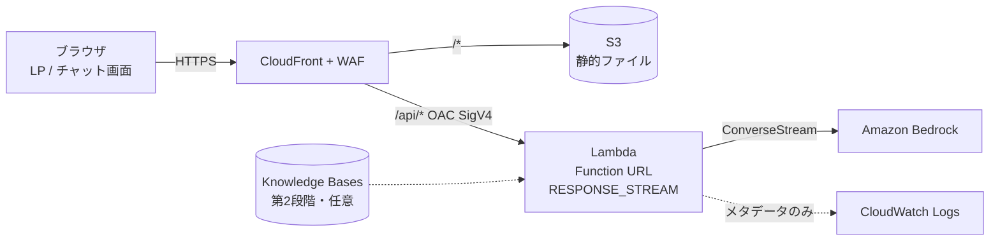

# 01. アーキテクチャ設計

## 1. 目的と前提

- GPTs 終了後も、社外公開の相談窓口(5 つのガイドさん)を継続する。特定 AI サービスの仕様変更に左右されない。
- 運営はボランティア中心 → **部品点数を最小**にし、保守できる構成にする。
- 匿名で公開するため、**課金の暴走防止**と**プライバシー**(質問を保存しない)を最優先の非機能要件とする。

## 2. 構成



| 要素 | 役割 | 設計判断 |
|---|---|---|
| CloudFront | 単一ドメインで LP と API を配信 | 同一オリジンのため **CORS 不要**。HTTPS 強制、セキュリティヘッダ(CSP/HSTS 等)付与 |
| WAF (us-east-1) | レート制限・悪性 IP 遮断 | 課金対策の第一線(詳細 [03](03-security-cost.md)) |
| S3 | `web/` を保管 | 非公開バケット。CloudFront の OAC からのみ読み取り |
| Lambda Function URL | `/api/chat` | API Gateway を使わない(部品削減)。`RESPONSE_STREAM` で逐次応答。`AWS_IAM` 認証 + CloudFront OAC で **CloudFront 経由以外は拒否** |
| Bedrock | 生成 | ConverseStream。モデルは変数で差し替え可能 |
| CloudWatch | ログ・アラーム | ログは**本文を含まない**メタデータのみ |

使わないもの: API Gateway / DynamoDB / Cognito / VPC / ECS。

## 3. 主要な設計判断(ADR 要約)

| # | 判断 | 理由 | トレードオフ |
|---|---|---|---|
| 1 | API Gateway ではなく Function URL | 部品削減、ストリーミング、低コスト | API キー・使用量プラン等は使えない → WAF と同時実行数上限で代替 |
| 2 | ステートレス(履歴はブラウザ保持) | DB 不要、質問を保存しない方針と整合 | 履歴は `sessionStorage` のみ。タブを閉じると消える。リクエストごとに履歴を送るため入力トークンが増える(件数・文字数上限で抑制) |
| 3 | ナレッジはプロンプト同梱(第1段階) | 最小構成。プロンプトキャッシュが効く | 量が増えるとコスト・品質に影響。約 40 万文字を超えたら第2段階へ |
| 4 | Lambda は Node.js 22 / TypeScript | Function URL のレスポンスストリーミングがネイティブ対応 | — |
| 5 | IaC は Terraform | 計画資料の選択肢から選定 | WAF/ACM 用に us-east-1 プロバイダを併用 |
| 6 | 認証なし(匿名公開) | 「アカウント不要」が価値 | 悪用対策は WAF・上限・予算アラームに依存 |
| 7 | フロントはビルド不要の素の HTML/JS | ボランティアが保守しやすい。外部 CDN/フォント未使用(プライバシー・CSP) | 高度な UI 機能は自作 |
| 8 | Markdown 描画は自前の最小実装 | 依存ゼロ。先にエスケープするため XSS しにくい | 表などは非対応 |

## 4. リクエストフロー

1. ブラウザが `/chat/?guide=run` を開く(CloudFront Function が `/chat/` → `index.html` に書き換え)。
2. 質問送信 → `POST /api/chat`(本文の SHA-256 を `x-amz-content-sha256` に付与。OAC が Lambda に POST する際の必須要件)。
3. WAF がレート制限を判定 → CloudFront が SigV4 署名して Lambda Function URL へ転送。
4. Lambda が検証・切り詰め → `prompts/<guide>.md` + ナレッジを system に設定 → Bedrock ConverseStream。
5. 差分を SSE でブラウザへ逐次返却。完了時にトークン使用量等のメタデータのみログ出力。

## 5. ディレクトリ構成

```
web/                     LP(index.html) と /chat/、assets/(CSS・JS)
backend/src/             handler.ts(Lambda 入口) chat.ts(処理本体) validate.ts bedrock.ts prompts.ts
backend/prompts/         ガイド別システムプロンプト(5 つ)
backend/knowledge/       共通・ガイド別ナレッジ(Markdown)
backend/scripts/         build.mjs(esbuild) dev-server.ts(ローカル確認)
infra/terraform/         *.tf(s3 / cloudfront / waf / lambda / monitoring / domain)
```

`chat.ts` は AWS 依存を持たない(`bedrock.ts` のみ)ため、Lambda とローカル開発サーバーで同一ロジックを使う。`MOCK_BEDROCK=1` で AWS なしの UI 確認ができる。

## 6. 既知の制約・留意点

- **404 ページ**: CloudFront のカスタムエラーページはディストリビューション全体に効き `/api/*` の応答を書き換えてしまうため設定していない。存在しない URL は S3 の標準エラーになる。
- **検証エラーの HTTP ステータス**: ストリーミング開始後の整合性のため、入力検証エラーは HTTP 200 の SSE `error` イベントで返す(JSON 不正・サイズ超過・メソッド違いは 4xx)。監視は Lambda ログの `status` フィールドで行う。
- **POST + OAC**: 直接 `curl` で試す場合も `x-amz-content-sha256` が必要([smoke-test.sh](../../scripts/smoke-test.sh) 参照)。
- **同時実行数の予約**: 新規 AWS アカウントでは予約できない場合がある(`lambda_reserved_concurrency` の説明参照)。
- **モデル ID**: `bedrock_model_id` の既定値は例。デプロイ前に利用可能な ID を確認し、Bedrock のモデルアクセスを有効化すること。
